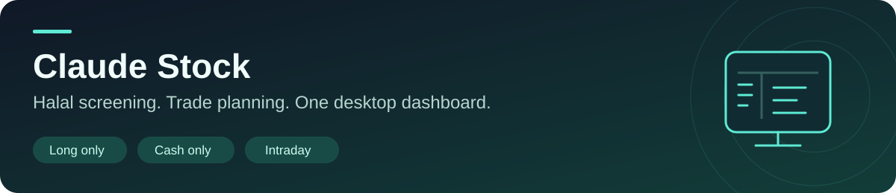
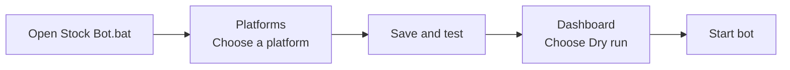
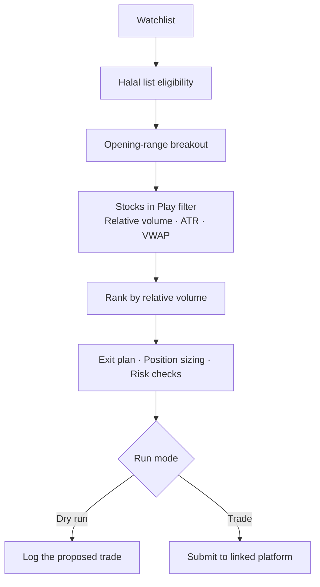

# Halal stock trading bot

A desktop app that runs a day-trading bot on halal stocks: it opens trades, closes them, and shows everything on a dashboard.

[Start](#start-the-app) · [Platforms](#link-a-trading-platform) · [Run modes](#run-the-bot) · [Strategy](#the-strategy) · [Halal screen](#what-keeps-it-halal) · [Developer guide](#adding-another-platform)

## Start the app

Double-click **`Stock Bot.bat`**. A window opens with the dashboard. Keep the small black window open while the bot runs.

(From a terminal: `python3 app.py`.)

## Link a trading platform

Open **Platforms** in the app, pick one, paste what it asks for, and press **Save and test**.

| Platform | What it trades | What you enter | Practice account |
| --- | --- | --- | --- |
| Simulator (built in) | US stocks, fake money on this computer | nothing | yes |
| Interactive Brokers (beta) | US stocks | gateway address + account ID (no API key) | yes (accounts starting `DU`) |
| MEXC | tokenized US stocks on spot (e.g. `AAPLX`), paid in USDT | Access Key + Secret Key | no - real money |
| Alpaca | US stocks | API Key ID + Secret Key | yes |

Each card in the app says whether the platform is available in Israel and lists the steps to get the keys.

Keys are saved only on this computer in `data/accounts.json` (never uploaded, never shown again in the app). The file is not encrypted, so do not share the `data` folder. On MEXC, create the key with **Spot trading only** - no withdrawal, no futures.

## Run the bot

On the **Dashboard**, choose a mode and press **Start bot**:

| Mode | What happens | Money at risk |
| --- | --- | --- |
| 🔎 **Dry run** | Shows proposed trades; sends no orders | None from bot orders |
| 🧪 **Trade + practice account** | Sends simulated or paper orders | Practice funds |
| 💵 **Trade + real account** | Sends live orders after typing `REAL MONEY` | Real funds |

> **MEXC has no practice account in this app.** Trade mode uses real money.

The bot only works while the app is open. Default schedule, in **New York time**:

| 09:30–09:45 | 09:45–15:30 | 15:30 onward | 15:55 |
| :---: | :---: | :---: | :---: |
| 📊 Build the 15-minute opening range | 🔎 Look for entries | 🛑 No new entries | 🕒 Scheduled position close |

Times and opening-range length are configurable in Settings. Keep the app running for exit management.

## The strategy

*Simplified entry flow; account, timing and safety gates can also block a trade.*

<strong>Strategy rules, filter thresholds and research background</strong>

Opening-range breakout, long only: the first 5-minute bar that closes above the high of the first 15 minutes (Settings: 5, 15 or 30).

**Stocks in Play filter** (on by default, from Zarattini, Barbon & Aziz, *A Profitable Day Trading Strategy For The U.S. Equity Market*, 2024): a breakout is only taken when the stock is trading on unusual volume. The bot (`sip.py`) checks, from one free Yahoo request per breakout:

- **Relative volume** - volume in today's opening range vs the same window over the last 14 sessions, at least 1.0× (the paper's 100 %).
- **Daily ATR(14)** at least $0.50, so the move is worth the spread.
- **Price above today's VWAP.**

Breakouts that pass are ranked by relative volume, most unusual first. The paper's own exits (5-minute range, stop at 10 % of the daily ATR, hold to the close) can be picked in Settings: opening range "5 minutes", stop "10 % of the daily ATR", target "10 × risk". The default stays opening-range middle / 1.5R. Backtest results in the paper are not a promise; try it in Dry run or on a practice account first.

## What keeps it halal

- Only stocks marked **Halal** on the Halal list page are traded. The screen checks the business (no banks, insurance, alcohol, tobacco, gambling, pork, entertainment media, weapons) and AAOIFI-style ratios (debt < 30 %, cash + interest-bearing holdings < 30 % of market value, interest income < 5 % of revenue).
- Long only, cash only (no margin), spot only (no futures, options or leverage), no overnight holds.
- A stock that cannot be verified is never traded. You can block a stock or allow one yourself on the Halal list page.

The screen is an automated approximation from SEC filings, not a fatwa. Compare with Zoya or Musaffa, or ask your scholar. Tokenized stocks on MEXC are tokens backed by shares held by a custodian; whether that counts as owning the share is your call.

## Adding another platform

Write an adapter in `brokers/` (copy `brokers/alpaca.py`; the methods are listed in `brokers/base.py`) and add an entry with its input fields to `PLATFORMS` in `brokers/__init__.py`. It then appears on the Platforms page.

## Files

<strong>Source map, configuration and local data</strong>

- `app.py` + `ui/index.html` - the desktop app. `engine.py` - the bot. `halal.py` - the screen. `brokers/` - platform connections.
- `bot.py` - the same controls from a terminal (`python3 bot.py --help`).
- `config.json` - watchlist and limits (editable in the app's Settings page).
- `.claude/skills/` - the skills the bot runs (MIT): day-trader-skill (scanner, exit, budget, risk) and claude-trading-skills (market-breadth-analyzer).
- `data/` - keys, trade history (`trades.csv`), log (`bot.log`), halal cache. Not uploaded to git.

Not financial advice. Most day traders lose money.
